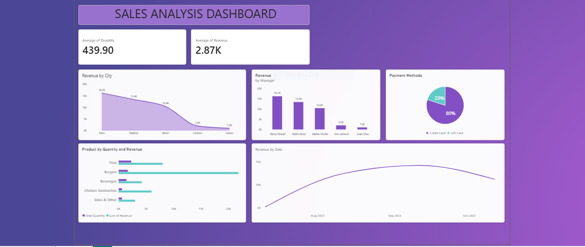

# 🍽️ Multi-City Restaurant Sales Performance Analysis

An interactive **Microsoft Excel** business intelligence dashboard and exploratory sales analysis tracking revenue, order volume, and product performance across multiple restaurant branches.

## 📌 Project Overview

Restaurant chains operating across multiple cities need clear visibility into regional revenue drivers, peak sales periods, and menu item performance to optimize inventory and staffing. This project transforms raw transactional sales records into a dynamic, automated Excel dashboard for executive decision-making.

## 🛠 Tools & Techniques

- **Data Cleaning & Transformation:** Microsoft Excel (Power Query, Text/Date Functions, Conditional Formatting)
- **Data Modeling & Aggregation:** Pivot Tables, Pivot Charts, Dynamic Formulas (`SUMIFS`, `COUNTIFS`, `XLOOKUP` / `INDEX-MATCH`)
- **Interactive Visualization:** Slicers, Timelines, KPI Summary Cards

## 🔍 Key Features

1. **Data Preparation & Standardization:**
   - Cleaned and standardized multi-city transaction logs, ensuring consistent date formats, city names, and currency values.
   - Created calculated fields for total revenue, order volume, and average order value (AOV).
2. **Interactive Executive Dashboard (`sales dashboard.xlsx`):**
   - Built dynamic slicers and timelines allowing stakeholders to filter performance by **City/Branch**, **Product Category**, and **Time Period**.
   - Automated weekly summary views to eliminate repetitive manual reporting.

## 📊 Key Analytical Highlights

- **Regional Performance Comparison:** Identifies top-revenue cities and underperforming branches to guide targeted promotions.
- **Menu & Category Mix:** Highlights high-demand items and peak ordering periods to support inventory planning.
- **Reporting Efficiency:** Streamlined recurring weekly sales summaries through dynamic Pivot Table templates.

## 🖼 Dashboard Preview

  

## 🚀 How to Explore This Project

1. Download **`sales dashboard.xlsx`** from this repository.
2. Open the workbook in **Microsoft Excel** (enable content/macros if prompted).
3. Use the interactive **Slicers** on the dashboard tab to filter metrics across cities, categories, and dates.

---

### 🤝 Let's Connect

- 💼 **LinkedIn:** [Ifeduba Amarachi Vincent](https://linkedin.com)
- 🐙 **GitHub Portfolio:** [@amarachi-analytics](https://github.com)
- 📧 **Email:** [amarachivi@gmail.com](mailto:amarachivi@gmail.com)
